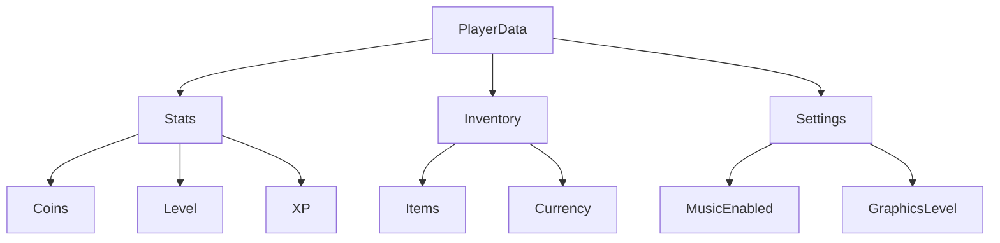
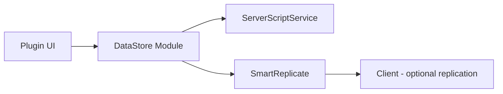
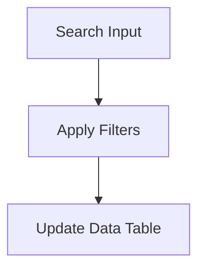

# DataStore Builder & SmartReplicate

## Security and compatibility maintenance (October 2026)

### Server-authoritative remote access

The server rejects direct client-originated data modifications by default. This prevents a client from changing currency or ownership by sending an arbitrary field path. Server code can deliberately allow a primitive configuration field:

```luau
local folder = VirtualData.new(player, data, Store)
folder:AllowClientUpdate("Settings.MusicEnabled", function(value, oldValue)
    return typeof(value) == "boolean"
end)
```

Only allow client-updated fields that are safe to trust. Gameplay awards must be calculated on the server. Remote module actions require an explicit allowlist on each module:

```luau
local ClickModule = {}
ClickModule.ClientActions = {OnClick = true}
function ClickModule.OnClick(player, folder)
    -- Server-calculated gameplay reward
end
return ClickModule
```

The bundled ClickModule enables its existing OnClick action; other exported functions are not available remotely. Both remote request channels have a minimum accepted interval of 0.1 seconds per player.

### Data replication privacy

Initial replication now sends public folders to everybody and private folders only to their owner. Transitioning a folder from public to private attempts to revoke values already replicated to other clients, but cannot make clients forget values they previously received. Never store secrets in replicated data.

**Compatibility:** Existing `RequestUpdate("Folder.Key", value)` calls retain their shape, but are rejected until server-allowlisted. Old scripts that expected any client to directly set any value will require explicit server-side rules. The companion transport modules `NetworkHandler.EventBus` and `Events` must be installed separately; they are not included in this repository.

**Verification:** Use a two-player Roblox Studio session to test private/public snapshots, malicious update attempts, approved field mutations, and ClickModule.OnClick. Full project type checking and benchmarks are still needed; this change is not a complete migration to `--!strict`.

---


full from the plugin as in Create Services it will replicated the required modules and scripts to the places except for Bnum


**DataStore Builder** is a Roblox Studio plugin that simplifies the
creation and management of structured DataStore modules.\
It provides a visual interface for organizing folders, defining typed
keys, editing values, and exporting modules directly into your
experience.

The plugin integrates with **SmartReplicate**, a secure client-server
replication system that ensures player data is validated, synchronized,
and safely shared when needed.

------------------------------------------------------------------------

## Yt Tutorial
https://www.youtube.com/watch?v=aXyyyM4RXKs

## Preview

``{=html}
``{=html}
``{=html}

``{=html}
``{=html}

``{=html}

------------------------------------------------------------------------

# Plugin Overview

DataStore Builder allows developers to manage complex data structures in
Roblox visually.

-   **Folder-based organization** for structured data\
-   **Type safety** to prevent errors\
-   **Instant editing** and updates\
-   **Module generation** and update management\
-   **SmartReplicate integration** for secure data replication

------------------------------------------------------------------------

# Features

  Feature                      Description                             Status
  ---------------------------- --------------------------------------- --------
  Folder-based DataStore       Organize keys in folders                ✅
  Typed Values                 Type-enforced keys for safety           ✅
  Module Generation            Automatic creation/update of modules    ✅
  Search & Filter              Quick search across all data            ✅
  SmartReplicate Integration   Safe client-server replication          ✅
  Middleware Support           Pre-save validation & transformations   ✅

------------------------------------------------------------------------

# Quick Start

1.  Install DataStore Builder plugin.\
2.  Open the plugin from the toolbar.\
3.  Create folder structure and define keys.\
4.  Save the DataStore modules.\
5.  Place SmartReplicate module in ServerScriptService.\
6.  Start the game; data will replicate securely.

------------------------------------------------------------------------

# Search Syntax

Use the search panel to filter your data quickly:

-   `folder:<name>` → search within a folder\
-   `key:<name>` → search by key\
-   `type:<type>` → filter by type (string, number, boolean, table)\
-   `value:<value>` → exact value match\
-   `min:<number>` / `max:<number>` → numerical range\
-   `!<key>` → exclude a key from search

------------------------------------------------------------------------

# Data Structure Example

``` text
PlayerData
├─ Stats
│  ├─ Coins (number)
│  ├─ Level (number)
│  └─ XP (number)
├─ Inventory
│  ├─ Items (table)
│  └─ Currency (number)
└─ Settings
   ├─ MusicEnabled (boolean)
   └─ GraphicsLevel (number)
```

### Mermaid Diagram Example



------------------------------------------------------------------------

# Plugin Architecture



This diagram shows how the plugin, module, server, and client interact.



```mermaid
flowchart LR
  DataTable["Data Table"] --> EditUI["Value Editor"]
  EditUI --> Update["Update DataStore Module"]
  Update --> Middleware["Run Middleware"]
  Middleware --> SmartReplicate["SmartReplicate"]
  ```

------------------------------------------------------------------------

# SmartReplicate Module

SmartReplicate is a Roblox Lua module designed to safely replicate
player data between the server and clients. It validates data, enforces
types, triggers events, and ensures safe public/private replication.

### Workflow

1.  **Setup**: Place the module in `ServerScriptService`.\
2.  **Create Player Folders**: Each player receives a `PlayerFolder`
    with default schema.\
3.  **Define Data**: Use `Define` to add items with type, default value,
    and replication mode.\
4.  **Listen for Changes**: Attach listeners to individual items or
    folders.\
5.  **Middleware**: Validate, transform, or enforce rules before
    saving.\
6.  **Update Data**: Call `Update` to change values; middleware and
    replication rules apply.\
7.  **Replication Modes**: Public = all clients, Private = only owner.\
8.  **Cleanup**: Folders are removed when players leave; events notify
    clients.

SmartReplicate abstracts the networking complexity for safe and reliable
multiplayer data handling.

------------------------------------------------------------------------

# Screenshots

### Plugin Icon


### Interface


### Folder Editor


### Data Editing Panel


### Toolbar


### Data Overview


------------------------------------------------------------------------

# Plugin Store

[Roblox Plugin Store
Link](https://create.roblox.com/store/asset/74000977808358/DataStoreService)

------------------------------------------------------------------------

# Example Client Script
```lua
local Client = require('@game/ReplicatedStorage/ClientHandler')
local Player = game:GetService('Players').LocalPlayer
local Bnum = require('@game/ReplicatedStorage/Bnum')

local TextButton = script.Parent.TextButton
local TextLabel = script.Parent.TextLabel
local new = Client.get(Player.UserId)

TextButton.Text = 'Clicks +' .. Bnum.format(new:GetData('PlusData.ClickPlus'))
TextLabel.Text = 'Clicks: ' .. Bnum.format(new:GetData('MainData.Clicks'))

new:OnChanged('PlusData.ClickPlus', function(new)
	TextButton.Text = 'Clicks +' .. Bnum.format(new)
end)

new:OnChanged('MainData.Clicks', function(new)
	TextLabel.Text = 'Clicks: ' .. Bnum.format(new)
end)

TextButton.MouseButton1Click:Connect(function()
	new:RequestModule('Click', 'UpdateClicks')
end)
```
------------------------------------------------------------------------
# Example Module Script as in RequestModule
must have module like


```lua
local module = {}
local TypeCheck = require(script.Parent.Parent.TypeChecks)
local Bnum = require('@game/ReplicatedStorage/Bnum')

function module.UpdateClicks(player, folder: TypeCheck.PlayerFolder)
	local data = folder.Data
	local MainData = data.MainData
	local PlusData = data.PlusData
	local Clicks = MainData.Clicks
	local ClickPlus = PlusData.ClickPlus
	Clicks = Bnum.toStr(Bnum.add(Clicks, ClickPlus))
	print(`{player.Name} has updated Clicks to: {Clicks}`)
	folder:Update('MainData.Clicks', Clicks)
end

return module
```

# Support

For errors, feedback, or feature suggestions, join the Discord server
[Discord Invite](https://discord.gg/xtEMCYmuKk)
